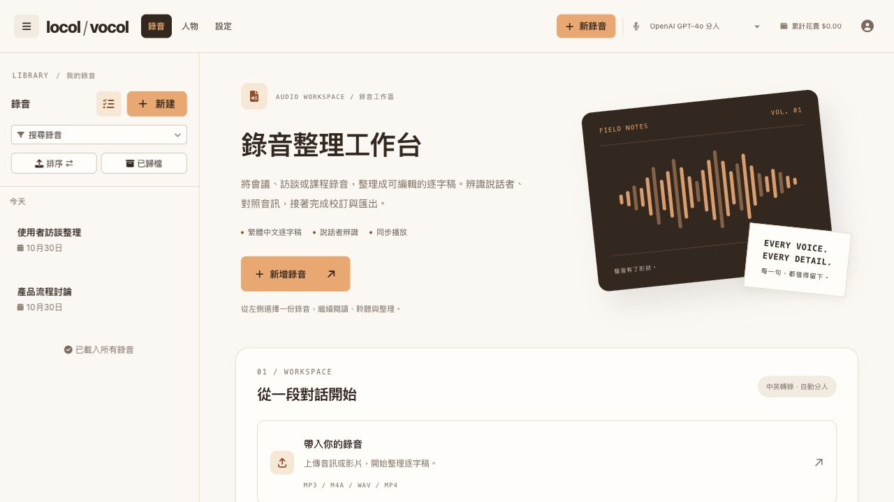
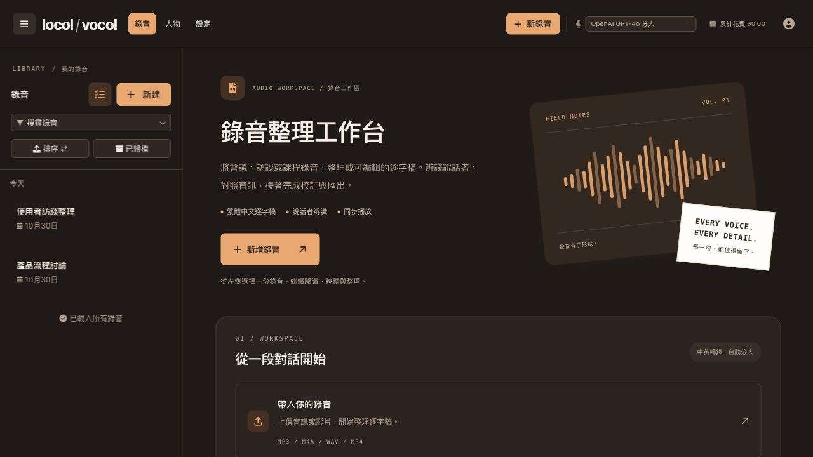
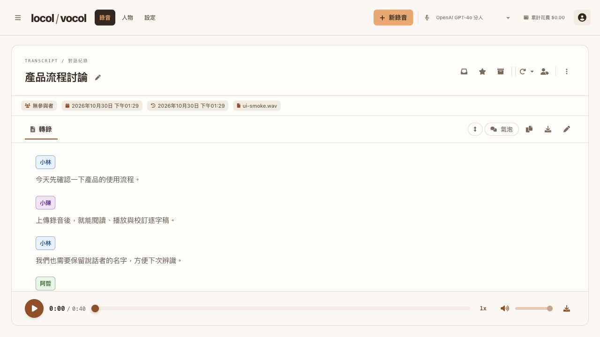
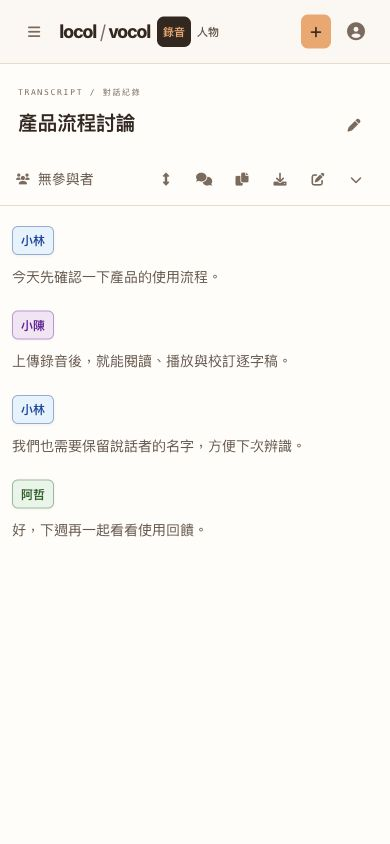

# Locol-Vocol

自架的會議逐字稿工具，取代 Vocol.ai 的核心用法：上傳錄音 → 中英文逐字稿 → 自動分人 → 雙擊說話者標籤一次改名。

以 [Speakr](https://github.com/murtaza-nasir/speakr)（AGPL-3.0，v0.10.13-alpha，commit `ba7e85c`）為基礎，`speakr/` 目錄是帶修改的原始碼副本。Locol-Vocol 新增的原創貢獻另以 MIT 授權，完整專案仍須遵守上游 AGPL-3.0，詳見[授權說明](LICENSE.md)。

## 跟上游 Speakr 的差異

- 轉錄引擎：新增 **ElevenLabs Scribe v2** 連接器（整檔一次送、最多 32 人、可指定中文），頁首下拉可即時切換 ElevenLabs / OpenAI gpt-4o-transcribe-diarize / AssemblyAI，各家 API key 分開存在系統設定
- 中文後處理：OpenCC `s2tw` 只轉字形不換用語、同一人連續發言合併、附和字保留在自己名下
- 逐字稿頁：拿掉右側摘要／筆記／統計欄，逐字稿全寬；雙擊說話者標籤直接改名（整篇同步）；雙擊段落跳到該時間點並播放；下載一鍵出 txt
- 進度與費用：轉錄中顯示百分比、段數、已用與預計時間；每筆錄音記錄引擎與估算費用；頁首顯示「儲值 − 累計花費」的預估餘額
- 多把 ElevenLabs key：`ELEVENLABS_API_KEYS` 逗號分隔，額度用完自動換下一把重送並記住可用的那把；頁首即時顯示使用中 key 的剩餘 credits（需 key 有 `user_read` 權限）
- 聲紋辨識（參照片段）：被命名過的人會保留每支錄音最多 30 秒的語音片段，存在 `uploads/voice_clips/`；新錄音轉錄時把所有人的片段接在音檔前面一起送出，引擎分到同一組的聲音就自動帶上名字（實測 ElevenLabs 跨場次 30 秒可正確歸隊，10 秒不行）。沒認出來時雙擊改名就會產生新片段。頁首選單的「人物」頁可播放片段、改名、合併、刪除片段，並可一鍵從既有錄音回填
- 介面全繁體中文；窄視窗預設顯示逐字稿
- 瘦身：拿掉摘要、聊天、分享、標籤／資料夾、範本、Webhook、群組、PWA 安裝、註冊與忘記密碼；管理頁只保留網址 `/admin` 可進

## 前端風格

介面以 PlaylistBridge／Songferry 的留白與工作區排版為基礎，採用奶油白與暖橘色配色。右上角選單可切換明亮／深色模式，選擇會保存在瀏覽器，並支援手機版。共用外觀集中在 `speakr/static/css/locol.css`，語意色彩變數在 `styles.css`；全站使用 Locol-Vocol 文字品牌，Speakr Logo 與來源授權保留於 `/references`。

登入後各頁共用固定頁首與錄音紀錄側欄；錄音、人物、設定及參考與致謝在同一工作區內切換，支援瀏覽器上一頁／下一頁。錄音首頁僅保留「帶入你的錄音」入口與音波圖，人物功能可從頁首進入。設定的關於頁連至本專案 GitHub 與 README。

## 介面預覽

以下畫面於 2026-10-30 重新擷取，全部使用虛構人物與示範逐字稿，不含實際會議資料。

### 明亮工作台

固定頁首保留錄音紀錄選單；首頁提供「帶入你的錄音」入口，右側保留音波圖。



### 深色工作台

從右上角使用者選單切換明暗模式；頁首不再重複顯示外觀按鈕。



### 逐字稿與播放

逐字稿採全寬閱讀區，支援說話者改名、段落定位播放與文字匯出。



### 手機版

窄視窗保留左上角錄音紀錄選單，底部分頁可切換逐字稿、人物辨識與錄音詳情。



## 使用方式

1. 點選「帶入你的錄音」或「新錄音」，上傳音訊／影片，或使用錄製功能。
2. 轉錄完成後，從左上角選單展開錄音紀錄，開啟逐字稿。
3. 雙擊說話者標籤修改名字；雙擊段落跳到對應時間並播放。
4. 校訂後下載文字檔；人物管理與偏好設定可從頁首進入，切頁不會重新載入整個網頁。

## 啟動

```bash
cp .env.example .env        # 填 ElevenLabs API key 和管理員密碼
docker compose build
docker compose up -d
# http://localhost:8899
```

需要 Docker（macOS 建議 OrbStack）。映像用 `LIGHTWEIGHT=1` 建，不含 PyTorch，所有辨識都在雲端 API 完成。

## 注意

- `.env`、`uploads/`、`instance/` 和根目錄的 `*.txt`（會議逐字稿）不進版控
- 改了 `speakr/` 之後：`docker compose build && docker compose up -d --force-recreate`，但不要在有錄音轉錄中時重建容器
- 後端的分享、標籤等功能只是介面隱藏，資料與路由仍在，想復原解開樣板裡的 `` 即可

## 授權與致謝

- Locol-Vocol 新增且由本專案作者持有著作權的原創程式與文件，依 [MIT License](LICENSE-MIT) 提供。
- Speakr 及其衍生程式碼保留 [AGPL-3.0](speakr/LICENSE)；MIT 不取代上游授權，也不表示完整專案可改用 MIT 發布。散布或提供本整合應用的網路服務時，仍須遵守 AGPL-3.0 的適用條款。
- 第三方套件、圖像與其他素材依各自授權提供。來源與 Speakr Logo 可在網站的「參考與致謝」頁查看。

授權適用範圍詳見 [LICENSE.md](LICENSE.md)。目前尚未發布本專案的 Docker Hub 映像，請使用原始碼自行建置。
